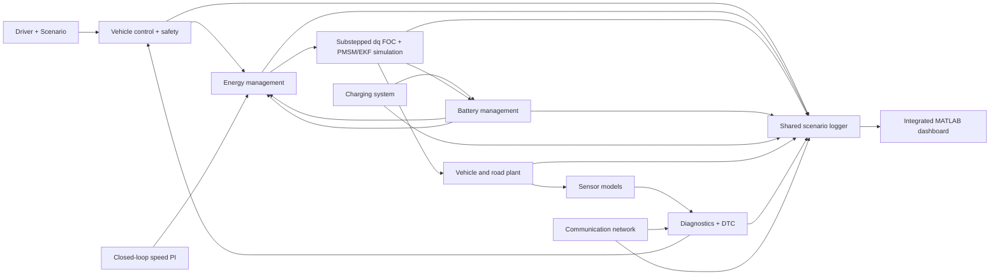

# Integrated EV software architecture

The folder layout separates functional areas by responsibility. The dashboard invokes a shared scenario runner; the runner connects driver/scenario requests to supervisory control, electrical subsystems, the road plant, and one common log schema.

## Functional areas

| Area | Responsibility and exchanged information |
|---|---|
| Vehicle control & safety | OFF/PRECHARGE/READY/DRIVE/ECO/REGEN/CHARGING/FAULT transitions; gates torque on faults and battery contactor state. |
| PMSM / motor control | Substepped dq PI loops, voltage-vector limiting, PMSM current equations, optional EKF Rs/flux feed-forward, and fixed-vs-adaptive matched-cycle metrics. No PWM switching model or MCU timing claim. |
| Battery management | Generic per-cell SOC/voltage/temperature, imbalance and passive-balance decisions, isolation latch, pack limits. Chemistry/cell-monitor behavior remains illustrative. |
| Charging system | Plug/enable state, assumed 7.2 kW power/current limit and SOC cutoff. Protocol remains explicitly unspecified. |
| Energy management | Closed-loop speed PI demand plus drive-mode scaling, pack discharge limit, speed cap, regenerative-braking acceptance, and friction-brake blending. |
| Sensors | Noisy speed/voltage samples and a repeatable speed-dropout injection. |
| Diagnostics | Sensor plausibility, BMS limits, pedal conflict, motor overcurrent, emergency stop, and network-timeout flags. Supplies DTC and safe-state request to the VCU. |
| Communication network | Periodic status-frame counters, approximate bus load, online/timeout status, lost frames, and injected link loss. It is not CAN bit-timing/network-stack validation. |
| Vehicle & road plant | Longitudinal inertia, gear/wheel conversion, rolling/aero/grade forces, and friction braking. |
| Scenario runner & logger | Repeatable scenarios and equal-length column vectors for all logged channels. |
| Dashboard | Scenario selection, subsystem descriptions, replay controls, status tiles, plots, and MAT log export. |

## State and fault behavior

VCU state IDs: 1 OFF, 2 PRECHARGE, 3 READY, 4 DRIVE, 5 REGEN, 6 CHARGING, 7 FAULT, 8 ECO. Diagnostics take priority and latch FAULT; reset is accepted only after the modeled initiating fault clears. The software model includes emergency stop, detected signal dropout, pack/cell limits, pedal conflict, overcurrent, network timeout/overload, and EKF numerical-health flags as torque-inhibiting events.

## Evidence limits

All parameters and sensor signals are illustrative. The BMS, charger, FOC response, communication network, and plant are software models for integration and demonstration. This project does not establish battery safety, charging-standard compliance, CAN conformance, motor-control stability, MCU timing, Proteus behavior, or hardware performance.
