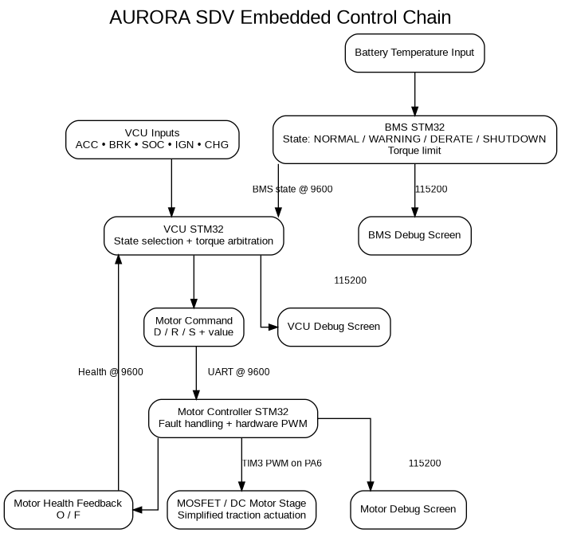
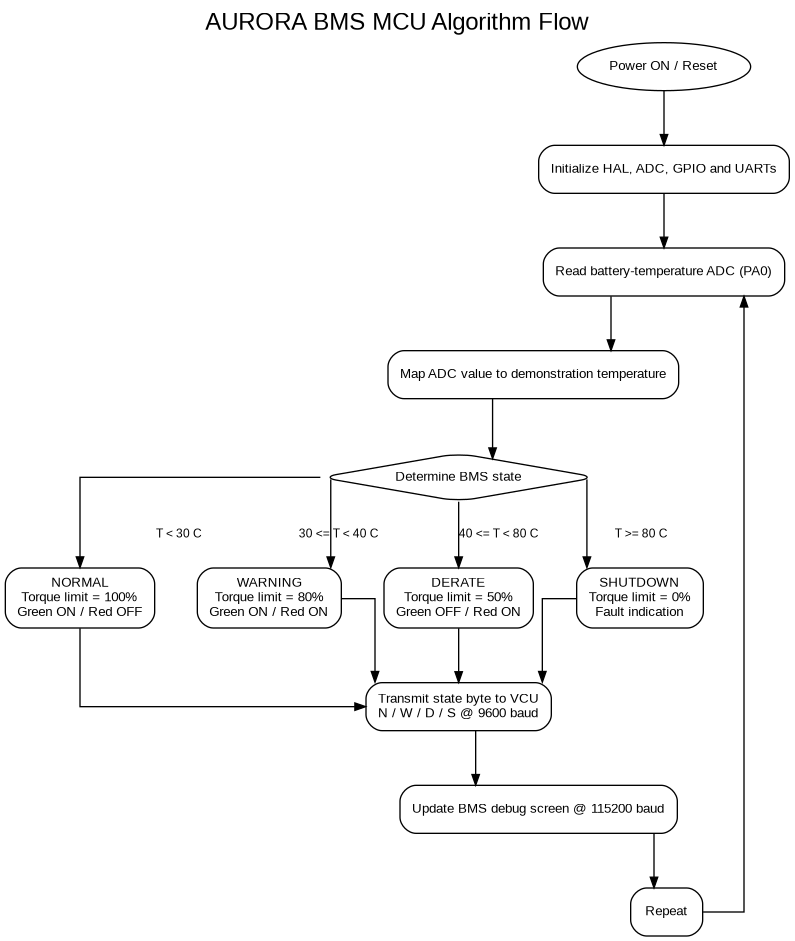
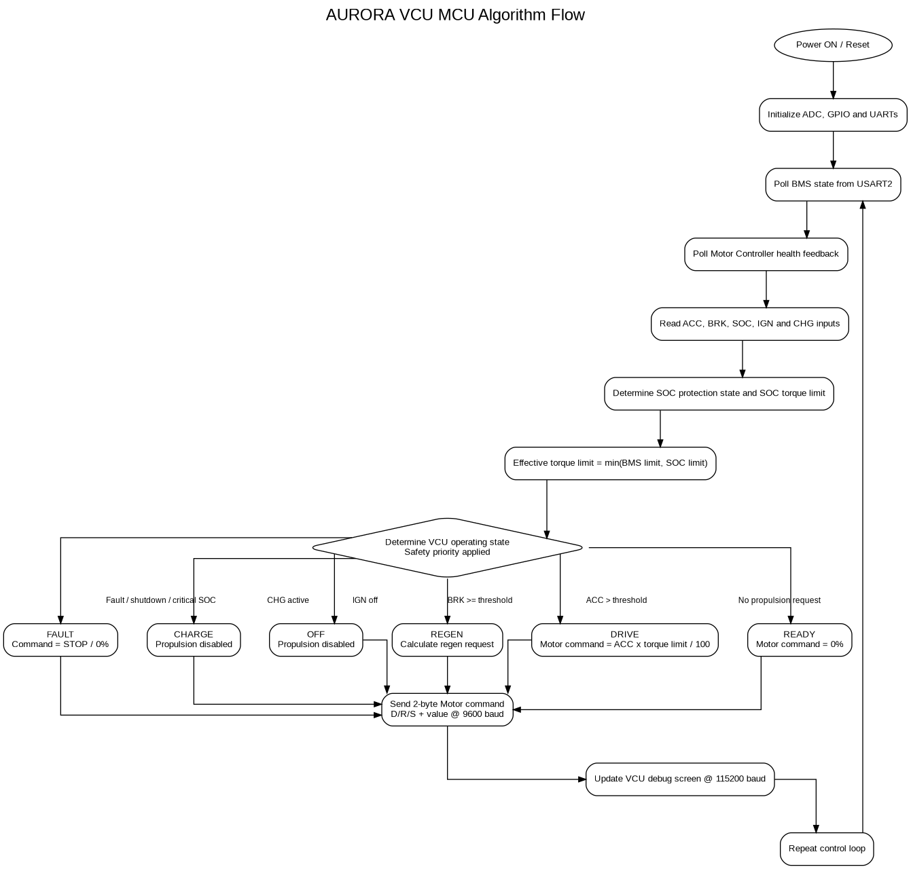
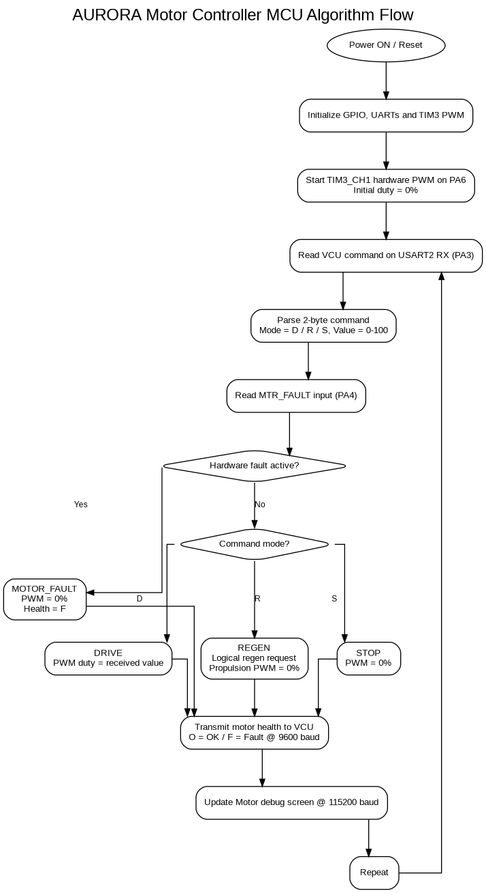

# AURORA MCU Flow Diagrams

This page contains the algorithm flow diagrams for the three STM32 controllers used in the Proteus prototype.

The PNG files are stored in:

```text
04_Images/
```

---

# 1. Overall Embedded Control Flow



The overall flow is:

- Battery temperature is processed by the BMS.
- BMS protection state is sent to the VCU.
- Driver inputs are processed by the VCU.
- The VCU calculates the final motor command.
- The Motor Controller generates PWM.
- Motor health is returned to the VCU.

---

# 2. BMS MCU Algorithm



The BMS algorithm performs:

1. MCU initialization
2. Battery-temperature ADC sampling
3. Temperature mapping
4. BMS state classification
5. Torque-limit selection
6. Green/red LED control
7. Transmission of `N`, `W`, `D`, or `S` to the VCU
8. Human-readable terminal update
9. Repeat

---

# 3. VCU MCU Algorithm



The VCU algorithm performs:

1. MCU initialization
2. BMS message polling
3. Motor-health polling
4. Accelerator, brake and SOC acquisition
5. Ignition and charge-switch acquisition
6. SOC protection evaluation
7. Effective torque-limit calculation
8. Vehicle-state selection
9. Motor-command calculation
10. Transmission of DRIVE / REGEN / STOP command
11. Human-readable terminal update
12. Repeat

Safety-related states are evaluated before normal driving states.

---

# 4. Motor Controller MCU Algorithm



The Motor Controller algorithm performs:

1. MCU initialization
2. TIM3 hardware-PWM initialization
3. VCU command reception
4. Mode/value decoding
5. Hardware-fault input check
6. DRIVE / REGEN / STOP processing
7. PWM update
8. Health-status transmission to VCU
9. Human-readable terminal update
10. Repeat

---

# 5. Communication Summary

```text
BMS → VCU
N / W / D / S
9600 baud
```

```text
VCU → Motor Controller
D / R / S + value
9600 baud
```

```text
Motor Controller → VCU
O / F
9600 baud
```

Debug screens operate separately at:

```text
115200 baud
```
