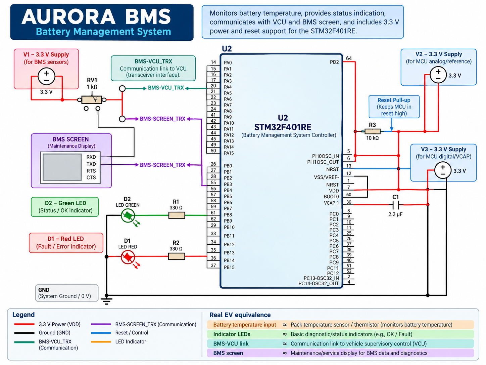
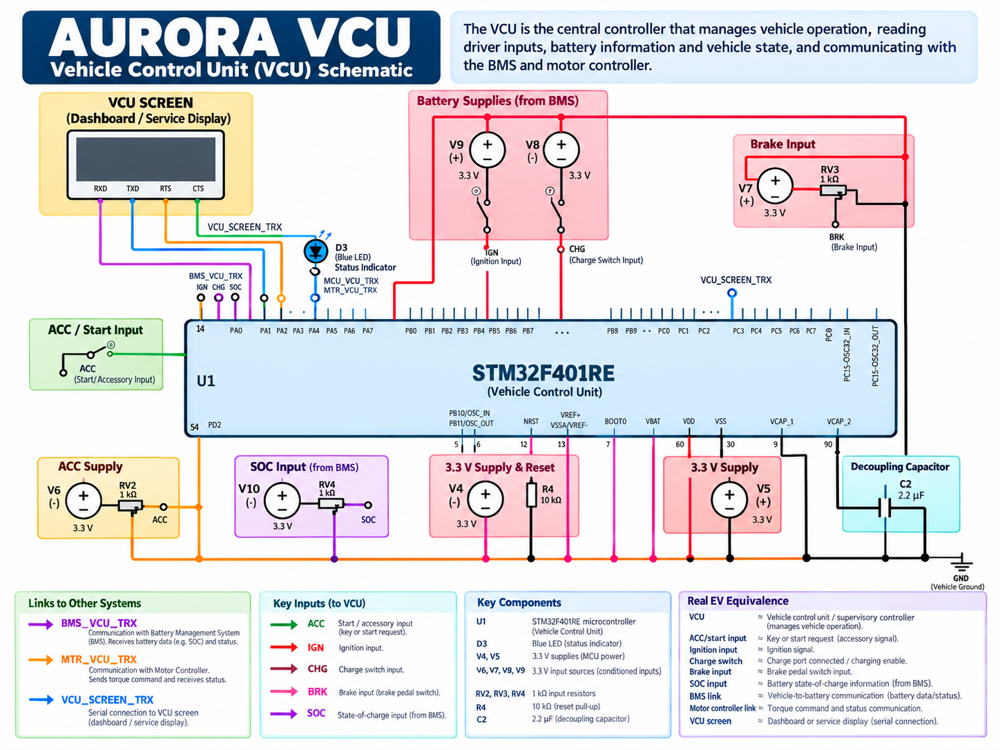
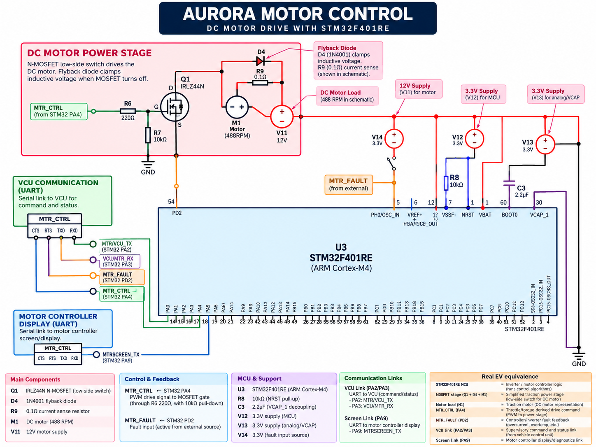

# AURORA Embedded Control System

## Overview

AURORA is an embedded electric vehicle control prototype developed using **Proteus** and **STM32 firmware**.

The embedded system is divided into three main control units:

- **BMS (Battery Management System)**
- **VCU (Vehicle Control Unit)**
- **Motor Controller**

Together, these controllers demonstrate a simplified EV control architecture covering battery protection, driver inputs, vehicle-state management, motor commands, PWM actuation, and fault feedback.

---

## Overall Embedded Architecture


The main control path is:

**BMS → VCU → Motor Controller → PWM / Motor Stage**

The Motor Controller also returns health and fault information to the VCU.

---

## Battery Management System (BMS)



The BMS monitors battery-related conditions and communicates the available torque limit to the VCU.

In the current Proteus prototype, the BMS handles:

- Battery-temperature input
- BMS state determination
- Torque-limit generation
- Green and red status LEDs
- Communication with the VCU
- Human-readable debug output

The BMS states are:

| Battery Temperature | State | Torque Limit |
|---|---|---:|
| Below 30 °C | NORMAL | 100% |
| 30 °C to below 40 °C | WARNING | 80% |
| 40 °C to below 80 °C | DERATE | 50% |
| 80 °C and above | SHUTDOWN | 0% |

> These temperature thresholds are demonstration values used to make each state easy to reach during Proteus testing.

The current Proteus BMS does **not** include a dedicated current sensor or SOC calculation. SOC is represented separately as an input to the VCU.

[View the BMS algorithm flow →](03_Documentation/05_MCU_Flow_Diagrams.md#2-bms-mcu-algorithm)

---

## Vehicle Control Unit (VCU)



The VCU acts as the main supervisory controller.

It receives:

- Accelerator input
- Brake input
- SOC input
- Ignition/start switch
- Charge switch
- BMS state
- Motor Controller health feedback

It then determines the current operating state:

- `OFF`
- `READY`
- `DRIVE`
- `REGEN`
- `CHARGE`
- `FAULT`

During normal driving, the VCU combines the accelerator request with the active protection limit to calculate the final motor command.

For example:

```text
Accelerator Request = 50%
Torque Limit        = 100%

Final Motor Command = 50%
```

If the BMS enters DERATE:

```text
Accelerator Request = 50%
Torque Limit        = 50%

Final Motor Command = 25%
```

Safety-related conditions take priority over normal propulsion requests.

[View the VCU algorithm flow →](03_Documentation/05_MCU_Flow_Diagrams.md#3-vcu-mcu-algorithm)

---

## Motor Controller



The Motor Controller receives the command generated by the VCU and converts it into a hardware PWM output.

The VCU-to-Motor command contains:

```text
Byte 1 = Mode
Byte 2 = Command value
```

Supported modes:

| Command | Meaning |
|---|---|
| `D` | DRIVE |
| `R` | REGEN |
| `S` | STOP |

During DRIVE, the Motor Controller generates hardware PWM using:

```text
PA6 → TIM3_CH1
```

The Motor Controller also monitors a motor-fault input and sends its health status back to the VCU:

| Status | Meaning |
|---|---|
| `O` | Motor Controller OK |
| `F` | Motor Controller fault |

[View the Motor Controller algorithm flow →](03_Documentation/05_MCU_Flow_Diagrams.md#4-motor-controller-mcu-algorithm)

---

## ECU Communication

The embedded prototype uses UART for communication between the three controllers.

| Communication Link | Protocol | Baud Rate |
|---|---|---:|
| BMS → VCU | `N / W / D / S` | 9600 |
| VCU → Motor Controller | `D / R / S + value` | 9600 |
| Motor Controller → VCU | `O / F` | 9600 |
| Human-readable debug screens | Text status output | 115200 |

The machine-control links and human-readable debug terminals are intentionally kept separate.

---

## Example: Normal Driving

A typical verified operating condition is:

### BMS

```text
STATE: NORMAL
TORQUE LIMIT: 100%
```

### VCU

```text
MODE: DRIVE
ACC: 50%
BRK: 0%
LIMIT: 100%
MTR CMD: 50%
MOTOR: OK
DTC: 0
```

### Motor Controller

```text
MODE: DRIVE
RX MODE: D
RX VALUE: 50
CMD: 50%
PWM: 50%
FAULT: NONE
DTC: 0
```

This demonstrates the complete embedded-control path:

**Driver input → VCU decision → Motor command → Motor Controller → Hardware PWM**

---

## Proteus-to-Real-EV Mapping

The Proteus model is a simplified embedded-control proof of concept.

| AURORA Proteus Element | Real-EV Equivalent |
|---|---|
| BMS STM32 | Battery Management System ECU |
| Battery-temperature potentiometer | Battery pack/module temperature sensor |
| VCU STM32 | Vehicle Control Unit |
| Accelerator input | Accelerator Pedal Position Sensor |
| Brake input | Brake request / pedal-position sensor |
| SOC input | SOC normally supplied by the BMS |
| Ignition switch | Vehicle enable/start request |
| Charge switch | Charging-state / charge-port signal |
| Motor Controller STM32 | Inverter / Motor Control Unit controller |
| TIM3 PWM output | Inverter gate-control command |
| MOSFET + DC motor | Simplified traction power stage and motor |
| UART links | Prototype equivalent of an automotive network such as CAN |
| Virtual Terminals | Engineering diagnostics / service interface |

For the detailed mapping, see:

[Proteus to Real EV Mapping](03_Documentation/04_Proteus_to_Real_EV_Mapping.md)

---

## Simulation Scope

The Proteus implementation focuses on embedded-system integration rather than full traction-motor physics.

It demonstrates:

- Distributed ECU architecture
- Battery protection and torque limiting
- Driver-input processing
- Vehicle-state management
- ECU communication
- Motor-command generation
- Hardware PWM
- Fault detection and propagation
- Diagnostic outputs

The detailed **PMSM, Field-Oriented Control (FOC), and Extended Kalman Filter (EKF)** work is handled in the MATLAB/Simulink portion of the wider AURORA project.

Regenerative braking is represented logically in the embedded controller, but the simplified single-MOSFET motor stage does not physically return energy to the battery.

---

## Repository Structure

```text
AURORA_Embedded_Control/
│
├── 01_Proteus/
│   ├── AURORA_SCH001.pdsprj
│   └── Firmware_Binaries/
│
├── 02_STM32_Firmware/
│   ├── AURORA_BMS/
│   ├── AURORA_VCU/
│   └── AURORA_MOTOR_CONTROLLER/
│
├── 03_Documentation/
│   ├── README.md
│   ├── 01_Embedded_Control_Overview.md
│   ├── 02_Pinout_and_Communication_Reference.md
│   ├── 03_Proteus_Run_and_Test_Guide.md
│   ├── 04_Proteus_to_Real_EV_Mapping.md
│   ├── 05_MCU_Flow_Diagrams.md
│   └── Reports/
│
├── 04_Images/
│
└── README.md
```

---

## Documentation

More detailed information is available directly in the repository:

- [Documentation Index](03_Documentation/README.md)
- [Embedded Control Overview](03_Documentation/01_Embedded_Control_Overview.md)
- [Pinout and Communication Reference](03_Documentation/02_Pinout_and_Communication_Reference.md)
- [Proteus Run and Test Guide](03_Documentation/03_Proteus_Run_and_Test_Guide.md)
- [Proteus to Real EV Mapping](03_Documentation/04_Proteus_to_Real_EV_Mapping.md)
- [MCU Flow Diagrams](03_Documentation/05_MCU_Flow_Diagrams.md)

---

## Running the Proteus Prototype

1. Open `01_Proteus/AURORA_SCH001.pdsprj` in Proteus.
2. Confirm that each STM32 references the correct ELF file in `01_Proteus/Firmware_Binaries/`.
3. Run the simulation.
4. Use the interactive inputs to change battery temperature, accelerator, brake, SOC, ignition, charging state, and motor fault.
5. Observe the BMS, VCU, and Motor Controller Virtual Terminals.
6. Compare the observed response with the expected scenarios in the [Proteus Run and Test Guide](03_Documentation/03_Proteus_Run_and_Test_Guide.md).

> Proteus may run significantly slower than real time because three STM32 models, ADC inputs, UART communication, PWM switching, the motor stage, and several Virtual Terminals are being simulated simultaneously.
